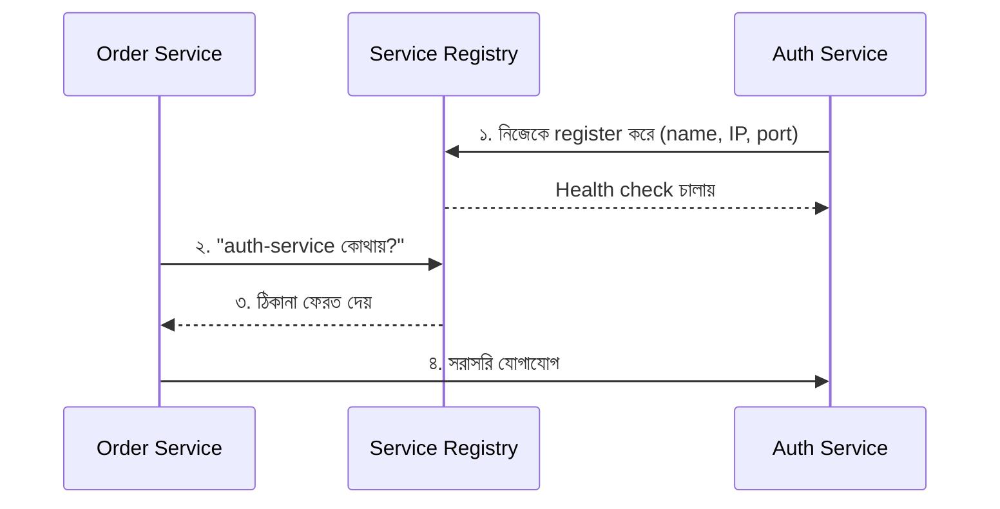

# Service Discovery: Consul ও Kubernetes-এ এর কাজ

> **সংক্ষেপে:** Service Discovery হলো এমন একটি প্রক্রিয়া, যার মাধ্যমে একটি service অন্য service-এর network address (IP ও Port) খুঁজে বের করতে পারে, যাতে তারা একে অপরের সঙ্গে যোগাযোগ করতে পারে।

---

## সূচিপত্র

1. [সমস্যাটা কোথায়?](#১-সমস্যাটা-কোথায়)
2. [Service Discovery কীভাবে কাজ করে?](#২-service-discovery-কীভাবে-কাজ-করে)
3. [দুটি মূল Pattern](#৩-দুটি-মূল-pattern)
4. [Consul কী?](#৪-consul-কী)
5. [Kubernetes-এ Service Discovery](#৫-kubernetes-এ-service-discovery)
6. [Docker Compose-এ Service Discovery](#৬-docker-compose-এ-service-discovery)
7. [Consul বনাম Kubernetes](#৭-consul-বনাম-kubernetes)
8. [NestJS Microservices-এ ব্যবহার](#৮-nestjs-microservices-এ-ব্যবহার)
9. [কোনটি কখন শিখবে?](#৯-কোনটি-কখন-শিখবে)
10. [মূল কথা](#১০-মূল-কথা)

---

## ১. সমস্যাটা কোথায়?

ধরো, তোমার NestJS Microservices প্রজেক্টে দুটি সার্ভিস আছে:

| Service | কাজ |
| --- | --- |
| `auth-service` | ব্যবহারকারী যাচাই করে |
| `order-service` | অর্ডার তৈরি করে |

`order-service`-কে `auth-service`-এর সঙ্গে যোগাযোগ করতে হবে। কিন্তু `auth-service` কোথায় চলছে, তার IP Address ও Port কী, এগুলো কীভাবে জানবে?

Microservices পরিবেশে service-গুলো **dynamically** start, stop ও scale হয়। তাই IP ও Port প্রায়ই বদলে যায়। একটি instance crash করলে নতুন instance অন্য IP-তে চালু হতে পারে। এই address manually hard-code করে রাখা সম্ভব নয়।

**এই সমস্যার সমাধানই Service Discovery।**

---

## ২. Service Discovery কীভাবে কাজ করে?



### ধাপে ধাপে প্রক্রিয়া

1. **Registration:** একটি service চালু হলে নিজের network address (name, IP, port, health check) registry-তে নিবন্ধিত করে। অথবা platform নিজেই সেটি discover করার ব্যবস্থা করে।
2. **Discovery:** অন্য service registry-কে জিজ্ঞেস করে, "`auth-service` কোথায়?"
3. **Resolution:** registry সঠিক address ফেরত দেয়।
4. **Communication:** দুই service-এর মধ্যে সরাসরি যোগাযোগ হয়।
5. **Health check:** registry নিয়মিত পরীক্ষা করে কোন instance সুস্থ আছে। মৃত instance তালিকা থেকে বাদ পড়ে।

### Service Registry-এর উদাহরণ

`Consul` · `Eureka` · `etcd` · `ZooKeeper`

---

## ৩. দুটি মূল Pattern

### Client-side Discovery

Client নিজেই registry থেকে instance-এর তালিকা নিয়ে load balancing করে।

- **সুবিধা:** বেশি control
- **অসুবিধা:** client-এ বাড়তি logic লাগে
- **উদাহরণ:** Netflix Eureka + Ribbon

### Server-side Discovery

Client একটি load balancer বা router-কে call করে। সেটি registry দেখে সঠিক instance-এ request forward করে।

- **সুবিধা:** client সহজ থাকে
- **অসুবিধা:** আলাদা load balancer/router লাগে
- **উদাহরণ:** AWS ELB, Kubernetes Service, Nginx

| বিষয় | Client-side | Server-side |
| --- | --- | --- |
| Load balancing কে করে | Client নিজে | Load balancer/router |
| Client-এর জটিলতা | বেশি | কম |
| Control | বেশি | কম |
| উদাহরণ | Eureka + Ribbon | Kubernetes Service, AWS ELB |

---

## ৪. Consul কী?

**Consul** হলো HashiCorp-এর একটি service networking tool। এটি service discovery, health checking এবং service-to-service communication-এর জন্য ব্যবহৃত হয়।

### Consul কী কী করতে পারে

- **Service Registry** হিসেবে কাজ করে
- Health check-এর মাধ্যমে কোন service সুস্থ আছে তা পর্যবেক্ষণ করে
- অন্য service-কে উপযুক্ত instance খুঁজে পেতে সাহায্য করে
- **Kubernetes-এর বাইরেও** ব্যবহার করা যায়

### উদাহরণ

`auth-service` Consul-এ register হলো। `order-service` Consul **DNS** বা **API** ব্যবহার করে `auth-service`-এর ঠিকানা খুঁজে পেল।

> **মনে রাখবে:** Consul-এর "Console" বা dashboard শুধু service পরিচালনা ও পর্যবেক্ষণের interface। আসল discovery mechanism শুধু dashboard নয়।

📖 অফিশিয়াল ডকুমেন্টেশন: [Consul Docs](https://developer.hashicorp.com/consul/docs)

---

## ৫. Kubernetes-এ Service Discovery

Kubernetes-এ Service Discovery সাধারণত **Kubernetes Service + DNS** ব্যবহার করে করা হয়।

### কেন সরাসরি Pod IP ব্যবহার করা যায় না?

ধরো, Kubernetes-এ তোমার দুটি component আছে: `order-service` Pod এবং `auth-service` Pod। Pod-এর IP address পরিবর্তিত হতে পারে, তাই সরাসরি Pod IP ব্যবহার করা নির্ভরযোগ্য নয়।

### সমাধান

`auth-service` নামে একটি **Service** তৈরি করলে Kubernetes DNS-এর মাধ্যমে অন্য Pod সেই নাম ব্যবহার করেই এটিকে খুঁজে পায়। Kubernetes Service একটি **স্থিতিশীল network endpoint** দেয় এবং উপযুক্ত Pod-এ traffic পাঠায়।

### DNS নামের ধরন

| অবস্থা | ঠিকানা |
| --- | --- |
| একই namespace | `http://auth-service:3000` |
| অন্য namespace | `http://auth-service.my-namespace:3000` |
| পূর্ণ DNS নাম (FQDN) | `http://auth-service.my-namespace.svc.cluster.local:3000` |

---

## ৬. Docker Compose-এ Service Discovery

Docker ব্যবহার করলে সবচেয়ে সহজ রূপটি তুমি আগেই দেখেছ। Docker Compose-এ **service name-ই হলো address**, যা Docker-এর internal DNS resolve করে দেয়।

```yaml
services:
  api:
    build: .
    environment:
      - DB_HOST=postgres   # service name-ই address
  postgres:
    image: postgres:16
```

এখানে `postgres` নামটি Docker-এর internal DNS নিজেই resolve করে। এটি Service Discovery-র সবচেয়ে সহজ রূপ।

---

## ৭. Consul বনাম Kubernetes

| বিষয় | Consul | Kubernetes |
| --- | --- | --- |
| মূল কাজ | Service discovery ও networking | Container orchestration এবং service networking |
| Discovery | Consul Registry, DNS/API | Kubernetes Service ও DNS |
| Health checking | Consul health checks | Readiness/liveness probes ও EndpointSlice-ভিত্তিক routing |
| Kubernetes ছাড়া ব্যবহার | ✅ হ্যাঁ | ❌ নিজস্ব discovery-র জন্য Kubernetes cluster দরকার |
| কখন ব্যবহার করবে | একাধিক environment বা advanced service networking | Kubernetes-এ deploy করা microservices |

---

## ৮. NestJS Microservices-এ ব্যবহার

### লোকাল TCP communication (Static addressing)

```ts
ClientsModule.register([
  {
    name: 'AUTH_SERVICE',
    transport: Transport.TCP,
    options: {
      host: '127.0.0.1',
      port: 5005,
    },
  },
]);
```

এখানে `host` ও `port` তুমি নিজেই নির্দিষ্ট করছ। এটি **static service addressing**, স্বয়ংক্রিয় service discovery নয়।

### Kubernetes-এ

একই ধরনের service-এর জন্য `host` হিসেবে **Kubernetes Service-এর DNS নাম** ব্যবহার করা যায়, যদি NestJS-এর TCP transport এবং Kubernetes Service-এর port configuration পরস্পরের সঙ্গে মেলে।

```ts
ClientsModule.register([
  {
    name: 'AUTH_SERVICE',
    transport: Transport.TCP,
    options: {
      host: 'auth-service',   // Kubernetes Service name
      port: 5005,
    },
  },
]);
```

---
